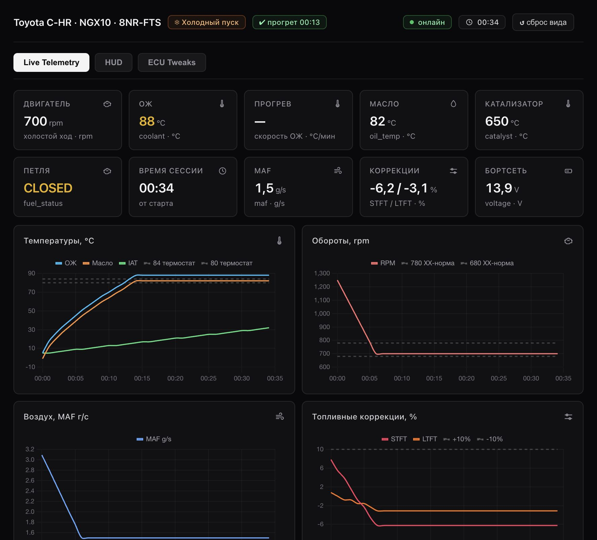

# C-HR OBD Tweaker — телеметрия и настройки Toyota C-HR NGX10 (8NR-FTS)

Инструмент для диагностики холодного пуска, живого мониторинга (HUD + графики) и настройки блоков ECU Toyota C-HR NGX10 (2016–2020, 1.2T 8NR-FTS, K114 CVT) с Android и macOS.



## Скачать Android APK

- Готовый APK (`chrtweaker_v1.0.0-debug.apk`) доступен в **[GitHub Releases](https://github.com/alexqem/chrtweaker/releases/latest)**.

## Быстрый запуск на macOS (с нуля)

```sh
git clone https://github.com/alexqem/chrtweaker.git
cd chrtweaker
chmod +x install_mac.sh && ./install_mac.sh
```

Скрипт создаст `.venv`, установит зависимости, подготовит `.env` и проверит Bluetooth/окружение (`doctor`). При первом запуске macOS может запросить разрешение на доступ к Bluetooth для терминала.

Основные команды после установки (`source .venv/bin/activate`):

```sh
python -m mycar capture                     # живой захват + веб-дашборд (http://127.0.0.1:8600)
python -m mycar capture --sim --sim-speed 60  # тест в симуляторе без машины
python -m mycar analyze                     # сводка последней сессии -> stats/
python -m mycar trend                       # тренд LTFT по всем сессиям
python -m mycar dtc                         # чтение и расшифровка ошибок
```

## Совместимость с OBD-II адаптерами

- **Базовая телеметрия** (холодный пуск, обороты, температуры, топливные коррекции, HUD) работает на любом BLE ELM327 v1.5+ адаптере.
- **Расширенные функции** (температура CVT и настройки Body ECU `0x750`/`0x7C0`/`0x7C4`) требуют адаптер с полноценной поддержкой `ATSH` и ISO-TP — рекомендуется **Vgate vLinker FD+ BT4.0**. Приложение само определяет возможности адаптера (`ATI`/`VTI`) и скрывает недоступные пункты с пояснением.

## Документация

| Тема | Файл |
|---|---|
| Веб-дашборд, телеметрия, структура проекта | [docs/DASHBOARD_AND_TELEMETRY.md](docs/DASHBOARD_AND_TELEMETRY.md) |
| Настройки ECU (`ECU Tweaks`) и выбор адаптера | [docs/ECU_TWEAKS.md](docs/ECU_TWEAKS.md) |
| Сборка Android APK и App Bundle | [docs/ANDROID_BUILD.md](docs/ANDROID_BUILD.md) |
| Паспорт авто и двигателя (NGX10, 8NR-FTS) | [docs/01-car-and-engine-ngx10.md](docs/01-car-and-engine-ngx10.md) |
| Mode-01 PID и формулы SAE J1979 | [docs/02-obd-pids-mode01.md](docs/02-obd-pids-mode01.md) |
| Нормы холодного пуска | [docs/03-cold-start-norms.md](docs/03-cold-start-norms.md) |
| macOS, Bluetooth и порты ELM327 | [docs/04-macos-bluetooth-elm327.md](docs/04-macos-bluetooth-elm327.md) |
| Чек-лист разбора лога и причины отклонений | [docs/05-cold-start-diagnostic-guide.md](docs/05-cold-start-diagnostic-guide.md) |
| Исследование топливных коррекций (LTFT) | [docs/06-fuel-trim-ltft-research.md](docs/06-fuel-trim-ltft-research.md) |
| Карта поддерживаемых PID и Mode 06/09 | [docs/08-empirical-pid-map.md](docs/08-empirical-pid-map.md) |
| Расширенный доступ к ECU (CVT, ABS, TPMS) | [docs/09-extended-ecu-access.md](docs/09-extended-ecu-access.md) |
